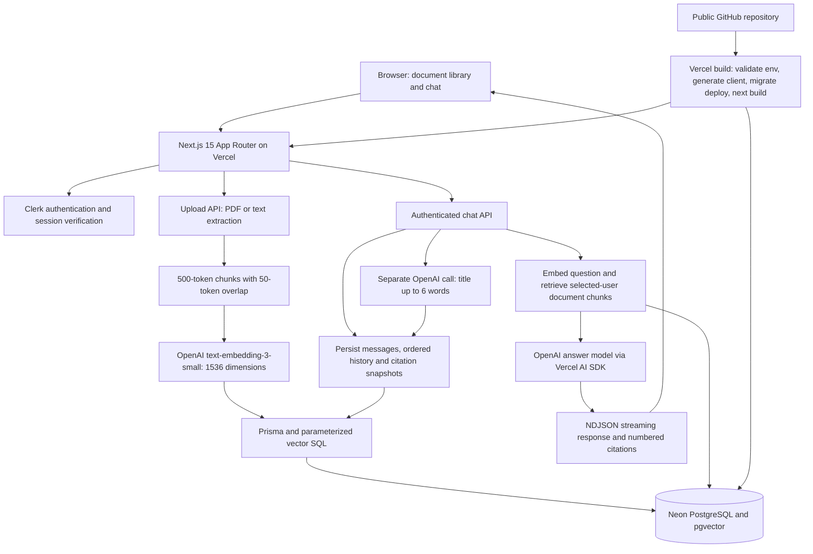

# Full-stack RAG Chatbot

Next.js 15 App Router, React, Tailwind, Clerk, Prisma, Neon PostgreSQL with pgvector, and Vercel AI SDK with OpenAI.

## Deployment links

**Public GitHub repository:** [developer26081992/ai_chat_bot](https://github.com/developer26081992/ai_chat_bot)

<!-- LIVE_URL_START -->
**Live URL:** [Open the chatbot](<https://ai-chat-bot-one-bay.vercel.app>)
<!-- LIVE_URL_END -->

`deployment.json` records the deployment URL and verification time when available.
After deploying, run `npm run deployment:record -- https://YOUR-ACTUAL-VERCEL-DOMAIN`
to verify the public home page and replace the pending status above. This command
does not invent a URL or deploy the application.

## Architecture



The browser never receives OpenAI, database, or Clerk secret keys. Every
conversation and retrieval query is scoped to the authenticated Clerk user.
Only `NEXT_PUBLIC_CLERK_PUBLISHABLE_KEY` is intentionally exposed to the client.

## Environment variables

Copy `.env.example` to `.env` locally. In Vercel, use **Project Settings >
Environment Variables** and select the appropriate Production, Preview and
Development environments. This application reads the following variables:

| Variable | Required | Purpose |
| --- | --- | --- |
| `DATABASE_URL` | Yes | Neon pooled PostgreSQL runtime URL, including `sslmode=require`. |
| `DIRECT_URL` | Yes | Neon direct PostgreSQL URL for migrations, without `-pooler` in the host and including `sslmode=require`. |
| `OPENAI_API_KEY` | Yes | Server-side OpenAI key with access to embedding and chat models. |
| `NEXT_PUBLIC_CLERK_PUBLISHABLE_KEY` | Yes | Public Clerk application key, needed during build and in the browser. |
| `CLERK_SECRET_KEY` | Yes | Server-side Clerk key from the same Clerk application and environment. |
| `OPENAI_CHAT_MODEL` | No | Chat Completions-compatible reply model; default `gpt-4o-mini`. |
| `OPENAI_TITLE_MODEL` | No | Separate title model; defaults to `OPENAI_CHAT_MODEL`, then `gpt-4o-mini`. |

Modal Clerk sign-in is used, so custom `SIGN_IN_URL`, `SIGN_UP_URL`, redirect
URL, webhook, JWT, and issuer variables are not required by this code. Configure
the application's actual local and production domains in the Clerk Dashboard.
Use a matching production key pair for a production Clerk instance, and rebuild
after changing the public key. Preview deployments should use a separate Neon
branch and appropriate Clerk environment rather than a shared production database.

`NODE_ENV` is set by Next.js/npm; Vercel's deployment variables are supplied by
Vercel. They are not secrets you need to add for this app. A `VERCEL_TOKEN`, if
used for CLI automation, is a deployment credential and is not required at app
runtime or included in `.env.example` or the portable archive.

## Implemented scope

Authenticated PDF/text upload, 500-token chunks with 50-token overlap, text-embedding-3-small embeddings (1536 dimensions), atomic vector storage, and a user-scoped document library. Part (c) adds document-scoped streaming chat, persistent conversation history loaded on the server, generated titles, a conversation sidebar, and expandable source citations. The detailed Q1 implementation uses Neon. Supabase and Stripe are not implemented; confirm with the assessor whether the general framework list requires them in addition to the detailed Q1 stack.

## AI usage declaration

OpenAI Codex assisted with generating the implementation, documentation, and tests. The application sends extracted document chunks to OpenAI for embeddings, conversation context and retrieved excerpts for answers, and the first question in a separate call for conversation titles. Review generated code and validate it in your own environment before production deployment.

## Local setup

1. Install Node.js 22 LTS (the Vercel runtime is pinned to `22.x`) and run `npm ci`.
2. Copy `.env.example` to `.env`. Configure a Neon database, a Clerk application, and an OpenAI API key. Never commit secrets. DATABASE_URL is the pooled Neon URL; DIRECT_URL is the direct connection used for migrations. Both must use SSL.
3. Run `npm run db:migrate`, then `npm run db:generate`. The initial migration enables pgvector and creates the tables and cosine HNSW index. The second migration adds selected document IDs, citation snapshots, message order/status, conversation activity timestamps, and generation guards. Existing messages are backfilled in chronological order. Your migration database role must have permission to enable pgvector; you can also enable it first in Neon's SQL editor. Existing conversations without selected documents remain readable; start a new conversation to select sources.
4. Run `npm run dev`, open http://localhost:3000, sign in, and upload a PDF or .txt file. Open `/chat`, select 1–10 documents, and ask a question. Revisit the conversation at `/chat/[id]` or `/conversations` (`/conversation` redirects there).
5. Run `npm test` and `npm run typecheck`. `npm run build` validates the environment, generates Prisma Client, applies production migrations, and builds Next.js. Use `npm run build:local` to compile without applying migrations; Clerk's publishable key is still needed for prerendering. `npm start` serves a successful production build.

On Windows, `powershell -ExecutionPolicy Bypass -File scripts/start-local.ps1`
creates the initial environment template if needed, installs dependencies when
missing, checks configuration, migrates, and starts the development server.

## pgvector and production migrations

The migrations are committed under `prisma/migrations`. With real connection
URLs configured, run:

```sh
npm run check:env
npm run db:migrate
npm run db:generate
```

`npm run db:migrate` runs `prisma migrate deploy`. The first migration executes
`CREATE EXTENSION IF NOT EXISTS vector`, creates the four tables, and adds the
cosine HNSW index on `vector(1536)`. The second migration adds conversation
document selections, ordered messages, timestamps, statuses and citation
snapshots. Prisma uses `DIRECT_URL` for migration access. The migration role
must be allowed to enable the extension; alternatively enable it in the Neon SQL
editor first:

```sql
CREATE EXTENSION IF NOT EXISTS vector;
SELECT extname, extversion FROM pg_extension WHERE extname = 'vector';
```

Every Vercel build is configured by `vercel.json` to run `npm run build`, whose
exact sequence is:

```sh
npm run check:env && prisma generate && prisma migrate deploy && next build
```

Migrations are applied before compilation, and a migration failure stops the
build. Applied migrations are tracked by Prisma and are not reapplied on every
deployment. Do not run `prisma migrate dev` or `prisma db push` against the
production database. If the database already has manually created tables,
baseline it using Prisma's documented migration workflow before deployment.

## API

`POST /api/documents/upload`: authenticated multipart/form-data with a `file` field. Returns HTTP 201 with `{ id, name, createdAt, chunkCount }`. Clerk session cookies are required; clients cannot choose a userId. Accepts files up to 4 MiB, PDFs up to 200 extracted pages, extracted text up to 500,000 characters, and at most 250 chunks. Scanned PDFs need OCR externally. Only UTF-8 text is accepted. Malformed inputs return 4xx; upstream/database failures return a generic 502. Embeddings are generated before the transaction; a database failure leaves no partial document but can still incur OpenAI charges. Retries create a separate document.

`GET /api/documents`: returns the latest 100 documents belonging to the signed-in user, including chunk counts. Content and vectors are not returned.

Vector writes use parameterized Prisma SQL because Prisma does not directly support vector fields. All chunk vectors and the document are committed together. The upload route uses the Node runtime and a 60-second function duration, with a 40-second embedding timeout. Larger ingestion workloads need a queue, object storage, OCR workers, and per-user quotas/rate limiting before a broad public rollout.

## Conversations and citations (Part c)

- `/chat`: new conversation with a document selector. Selected documents are fixed after the first question.
- `/chat/[id]`: authenticated server component loads the complete ordered history and saved source snapshots before rendering. Another user's conversation returns not found.
- `/conversations`: lists all the signed-in user's conversations by most recent activity, with titles and SAST timestamps. The same list appears in the responsive chat sidebar.
- Each assistant reply renders inline `[1]`, `[2]` buttons linked to native expandable footnotes. Opening a footnote shows the document name, chunk number, and original chunk text. Only sources actually referenced by that reply are shown. Citation snapshots are persisted in `Message.sources`, so numbering and original text survive reloads and document changes. Citation links identify retrieved passages; they do not establish that a model's interpretation is correct.
- A separate bounded LLM call generates a title after the first user message. The server enforces a maximum of six words. A six-word title derived from the question is saved immediately as a fallback if title generation fails. Follow-up messages do not retitle the conversation.

`POST /api/chat` accepts JSON `{ "message": "Your question", "documentIds": ["document-uuid"] }` for a new conversation, or `{ "message": "Follow-up", "conversationId": "conversation-uuid" }` for an existing one. User identity, message history, saved sources, and the existing document selection always come from the server. The message limit is 8,000 characters and the request-body limit is 64 KiB. Selected document IDs and conversation ownership are checked before creating messages.

The chat form uses React 19 `useActionState` and the `submitChat` Server Action. The action authenticates and runs the same RAG handler as the HTTP API, returning a React Flight ReadableStream so tokens render progressively.

The HTTP API reply is NDJSON (`application/x-ndjson`) with `conversation`, `sources`, `delta`, `title`, `done`, and `error` events; see `lib/chat-types.ts`. `done` is sent only after the assistant reply and cited source snapshots have committed. Validation/auth/config errors return JSON with non-2xx HTTP status before streaming. An interrupted reply retains the question and saves the partial assistant message with failed status when the database is reachable. Reopen the saved conversation before retrying if a network error makes the result unclear; automatic resubmission is intentionally avoided.

Retrieval embeds the latest two user questions for follow-up context and uses cosine similarity to fetch up to five chunks, filtered by both user ID and selected document IDs. The answer model receives up to 12,000 tokens of recent complete-message context; the page still loads the full saved history. Prior-turn citation markers are removed from model context because numbering is local to each answer. Unsupported citation numbers are marked unavailable rather than linked to invented sources. A per-conversation generation guard rejects overlapping requests with 409 and can recover a stale guard after two minutes. Failed or interrupted messages are visible in history and do not become completed assistant context.

`GET /api/conversations` lists only the signed-in user's conversations. `GET /api/conversations/[id]` returns that user's conversation and complete ordered messages or 404. Both require Clerk authentication.

Replies and titles default to `gpt-4o-mini`. Set optional `OPENAI_CHAT_MODEL` and `OPENAI_TITLE_MODEL` to Chat Completions-compatible model IDs available to your OpenAI account. The existing AI SDK 4 integration is retained; embeddings remain `text-embedding-3-small` with 1536 dimensions.

### Verify Part (c) with configured services

1. Apply both migrations. Upload two documents with different facts, then start `/chat` with only one selected. Ask a question supported by that document.
2. Confirm streamed text, a generated title of at most six words in the sidebar, and numbered citation footnotes that expand to the exact original chunk text.
3. Send a follow-up, reload `/chat/[id]`, and confirm both turns and their citation text remain in order. Confirm the title is unchanged.
4. Open `/conversations`, follow a title back to its history, and use New conversation during a stream to verify a fresh document selector appears.
5. Sign in with a different Clerk account. Verify their list excludes the first user's conversations and requests for the first user's conversation or document IDs return 404.
6. Send simultaneous messages from two tabs; one should receive 409. Simulate an interrupted reply, then reopen history to inspect any saved partial text.

## Verify live storage

Upload a short .txt file, then a multi-page text-based PDF. Verify they appear in the library. In Neon SQL editor:

```sql
SELECT extname FROM pg_extension WHERE extname = 'vector';
SELECT d.id, d.name, count(c.id) AS chunks,
       min(vector_dims(c.embedding)) AS dimensions
FROM "Document" d
JOIN "DocumentChunk" c ON c."documentId" = d.id
GROUP BY d.id, d.name;
```

Expect dimensions = 1536 and positive chunk counts. Test signed-out uploads (401), unsupported files (415), unreadable PDFs (422), and oversized uploads (413). Sign in as a second user and confirm their library excludes the first user's uploads. Actual Neon/OpenAI integration requires valid credentials and is not replaced by the unit tests.

## Public GitHub repository and Vercel

The configured remote is https://github.com/developer26081992/ai_chat_bot.git. To publish using your authenticated Git installation:

```powershell
git init
git add .
git commit -m "Implement document ingestion and vector storage"
git branch -M main
git push -u origin main
```

The public repository URL is listed at the top of this README. Review staged
files before committing; `.env` files, `node_modules`, `.next`, Vercel account
metadata, and generated `deliverables/` are ignored. `.env.example` is included.

1. Import `developer26081992/ai_chat_bot` from GitHub into Vercel and select the
   Next.js framework and repository root directory.
2. Use the committed `vercel.json`: install command `npm ci`, build command
   `npm run build`, and automatic Next.js output settings. Node.js is `22.x`.
3. Add every required environment variable listed above to Production. For
   Preview, use an isolated Neon branch with its own pooled/direct URL pair.
4. Ensure the Neon direct migration role can enable pgvector. Configure the
   deployment domain in Clerk and use a matching Clerk key pair.
5. Deploy. Inspect the build log for successful Prisma migrations and the Next.js
   build. Open the resulting public application URL, sign in, upload the sample
   PDFs, and test citations/history. Vercel login/protection pages do not count
   as the public chatbot URL.
6. Record the actual working origin with `npm run deployment:record -- https://YOUR-ACTUAL-VERCEL-DOMAIN`,
   commit the updated README and `deployment.json`, and push them to `main`.
7. Regenerate the portable submission after recording the live URL so its README
   matches the deployed repository.

If the Vercel CLI is available and authenticated, `vercel link` connects the
local directory and `vercel --prod` starts a production deployment. Add secrets
through Vercel's settings or interactive `vercel env add NAME production`; do
not place secret values in shell commands, source control, or the README.

The upload and chat routes use the Node runtime with a 60-second function
duration. Vercel's request-size limits also apply; the app's file limit is 4 MiB
to leave room for multipart overhead.

## Sample PDFs and flash-drive submission

The repository includes two original text-based PDFs with two pages each:

| Sample | Useful test facts |
| --- | --- |
| [Riverbend Operations Handbook](samples/riverbend-operations.pdf) | Weekdays 08:30–16:30 SAST, laptop form RB-204, seven-day loans, two meeting-room capacities. |
| [Riverbend Product FAQ](samples/riverbend-product-faq.pdf) | Starter R120/month, Team R350/month, document allowances, 14-day refund request window. |

See [samples/README.md](samples/README.md) for questions, expected answers and
document-selection tests. Matching text files are included. Regenerate the PDFs
with `npm run samples:generate` without installing a PDF-generation dependency.

Create a fresh portable folder and ZIP:

```sh
npm run export:usb
```

The command prints the generated folder and ZIP paths under `deliverables/`.
They contain all source code, `package-lock.json`, Prisma migrations, tests,
documentation, `.env.example`, and both PDFs. Credentials and machine-specific
dependency/build folders are excluded. `START-HERE.txt` explains local startup.
This is a runnable local source copy with online Clerk, Neon, OpenAI and npm
access; it does not claim to work without those services or credentials.

Copy the generated folder and ZIP to your flash drive. You can alternatively
export and copy the folder to an existing destination directory:

```powershell
npm run export:usb -- --destination "E:\Submission"
```

The command creates a new submission folder and does not replace existing drive
contents. In the copied folder, run `node scripts/verify-portable.mjs` to check
the SHA-256 manifest before editing files. On another machine, copy the folder
locally, set `.env`, run `npm ci`, `npm run db:migrate`, and `npm run dev`.
An export stored in this workspace is not confirmation that a physical flash
drive has been written; the destination must be supplied and the copy verified.

Dependencies are sourced from the public npm registry and pinned by package-lock.json. Reference: [OpenAI embeddings API](https://developers.openai.com/api/reference/resources/embeddings/methods/create), [Vercel AI SDK embeddings](https://ai-sdk.dev/docs/ai-sdk-core/embeddings).


## Verification status

Neon pooled and direct connections were verified, both migrations were applied,
and pgvector plus the document tables were checked successfully. Clerk API
authentication succeeded. TypeScript checks and the production Next.js compilation
passed. The full production build also passed on Vercel: environment validation,
Prisma generation, `prisma migrate deploy` (no pending migrations), and Next.js
compilation. The public production homepage was verified at the Live URL above.
On Windows, stop the development server before running `npm run build` if
Prisma reports a locked engine DLL.

The public visibility of the GitHub repository was verified. Successful real
upload, answer streaming, generated titles and history after a real answer remain
unverified: the configured OpenAI account returned HTTP 429,
`credit_balance_exhausted` / `insufficient_quota`, on an embedding request.
A valid API key alone does not establish available credits. No mock output is
presented as a working OpenAI integration. The production homepage is live; authenticated document-to-answer testing and
a physical flash-drive copy are still pending.

The dependency audit reports unresolved advisories in the retained AI SDK 4,
Prisma 6 and transitive packages. The recommended automated fixes require major
upgrades, including moving away from the required Next.js 15 stack. This
submission must not be described as having a clean security audit.

Automated tests cover chunking, chat streams, six-word title limits, saved
citations, interrupted replies, fragmented streams, cancellation, environment
validation, and both sample PDFs. The chat form submits through React 19
`useActionState` and a Server Action; retrieval selects at most five chunks.

References: [Vercel environment variables](https://vercel.com/docs/environment-variables),
[Clerk on Vercel](https://clerk.com/docs/guides/development/deployment/vercel),
[Neon pgvector](https://neon.com/docs/extensions/pgvector),
[Prisma migrate deploy](https://docs.prisma.io/docs/cli/migrate/deploy).
